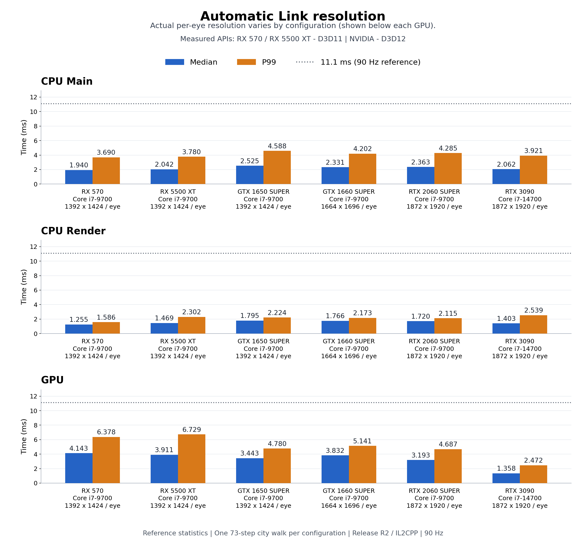
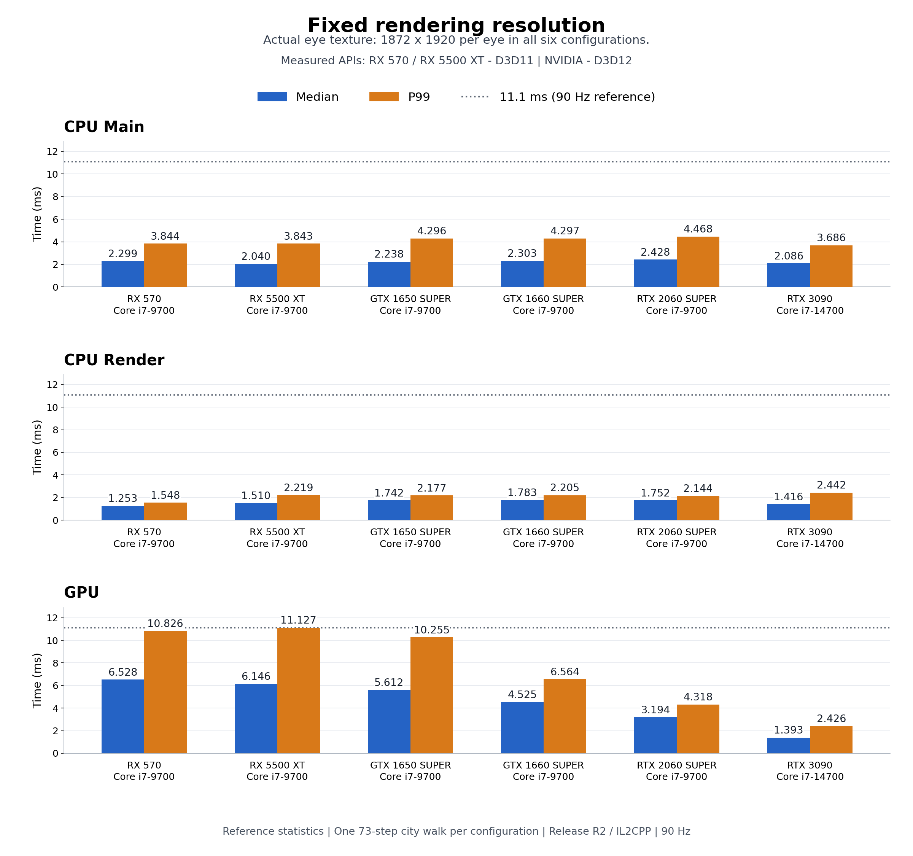

# PCVR性能評価（2026-11-08〜09）

測定日 2026-11-08〜2026-11-09

街・NPCを含む通常プレイ版の街歩き台本を、6種類のCPU／GPU構成で測定しました。Linkの自動解像度と固定解像度を分け、CPU Main・CPU Render・GPU時間の中央値とP99を掲載します。

グラフと主表のRX5500 XTは、2026-11-09に測定したD3D11の値へ更新しました。2026-11-08のD3D12測定は、後半の描画API比較表に掲載しています。

> このページはRelease候補R2の参考測定です。全実行に台本開始前のFocus停止があり、実行全体の自動判定は不成立のまま保存しています。ここでは、再開後の街歩き区間について完走・正常終了・表示条件など17項目を確認した参考統計を掲載しています。

## グラフの読み方

- 青は中央値、オレンジはP99です。P99は、計測値の99%が収まる時間です。
- 灰色の点線は11.1 msです。90Hzの1周期（約11.111 ms）を丸めた目安です。
- Main・Render・GPUの処理は重なって進みます。各指標は独立した分布として読みます。
- グラフの縦軸は、すべて同じ0〜12.9 msです。棒の上に計測値をms単位で表示しています。

## 自動解像度

Linkの解像度設定を自動にした条件です。実際の片眼解像度は構成ごとに異なります。解像度を含めた各構成での結果として比較してください。

表の時間はms、各セルは中央値 / P99です。解像度はアプリが記録した片眼の値です。

| GPU | 片眼解像度 | CPU Main | CPU Render | GPU時間 |
| --- | ---: | ---: | ---: | ---: |
| RX 570 | 1392×1424 | 1.940 / 3.690 | 1.255 / 1.586 | 4.143 / 6.378 |
| RX 5500 XT | 1392×1424 | 2.042 / 3.780 | 1.469 / 2.302 | 3.911 / 6.729 |
| GTX 1650 SUPER | 1392×1424 | 2.525 / 4.588 | 1.795 / 2.224 | 3.443 / 4.780 |
| GTX 1660 SUPER | 1664×1696 | 2.331 / 4.202 | 1.766 / 2.173 | 3.832 / 5.141 |
| RTX 2060 SUPER | 1872×1920 | 2.363 / 4.285 | 1.720 / 2.115 | 3.193 / 4.687 |
| RTX 3090 | 1872×1920 | 2.062 / 3.921 | 1.403 / 2.539 | 1.358 / 2.472 |

## 固定解像度

アプリが記録した実描画解像度は、全6構成で片眼1872×1920、Unity renderScaleは1.0です。

Linkの設定記録は、Radeonの2構成が3712×1888固定、NVIDIAの4構成が1.0x固定です。このグループは、実描画解像度が一致した条件としてまとめています。

表の時間はms、各セルは中央値 / P99です。

| GPU | CPU Main | CPU Render | GPU時間 |
| --- | ---: | ---: | ---: |
| RX 570 | 2.299 / 3.844 | 1.253 / 1.548 | 6.528 / 10.826 |
| RX 5500 XT | 2.040 / 3.843 | 1.510 / 2.219 | 6.146 / 11.127 |
| GTX 1650 SUPER | 2.238 / 4.296 | 1.742 / 2.177 | 5.612 / 10.255 |
| GTX 1660 SUPER | 2.303 / 4.297 | 1.783 / 2.205 | 4.525 / 6.564 |
| RTX 2060 SUPER | 2.428 / 4.468 | 1.752 / 2.144 | 3.194 / 4.318 |
| RTX 3090 | 2.086 / 3.686 | 1.416 / 2.442 | 1.393 / 2.426 |

## RX5500 XTの描画API比較

同じRelease R2・CPU・GPU・ドライバでの参考比較です。D3D12はnative＋Wave圧縮、D3D11はUnity API経路を使用しています。各条件は1回ずつの別実行で、頭部姿勢や切断履歴に差があります。

時間はmsです。CPU Main・CPU Render・GPU時間は中央値 / P99、フレーム間隔はP99を掲載しています。

| 解像度条件 | 描画API | 片眼解像度 | CPU Main | CPU Render | GPU時間 | フレーム間隔P99 |
| --- | --- | ---: | ---: | ---: | ---: | ---: |
| 自動 | D3D12 | 1392×1424 | 2.502 / 4.438 | 1.306 / 1.660 | 4.289 / 10.397 | 11.151 |
| 自動 | D3D11 | 1392×1424 | 2.042 / 3.780 | 1.469 / 2.302 | 3.911 / 6.729 | 11.150 |
| 固定 | D3D12 | 1872×1920 | 2.370 / 4.397 | 1.300 / 1.661 | 6.921 / 10.648 | 11.152 |
| 固定 | D3D11 | 1872×1920 | 2.040 / 3.843 | 1.510 / 2.219 | 6.146 / 11.127 | 22.222 |

## CPU・GPU構成

| GPU | CPU | OS | 描画経路 | GPUドライバ（Windows報告値） |
| --- | --- | --- | --- | --- |
| RX 570 | Core i7-9700 | Windows 11 Pro (build 26300) | D3D11 / Unity API | 31.0.21925.1001 |
| RX 5500 XT | Core i7-9700 | Windows 10 Pro (build 19045) | D3D11 / Unity API | 32.0.21045.16010 |
| GTX 1650 SUPER | Core i7-9700 | Windows 10 Pro (build 19045) | D3D12 / VP3C-native | 32.0.15.9186 |
| GTX 1660 SUPER | Core i7-9700 | Windows 10 Pro (build 19045) | D3D12 / VP3C-native | 32.0.15.9186 |
| RTX 2060 SUPER | Core i7-9700 | Windows 10 Pro (build 19045) | D3D12 / VP3C-native | 32.0.15.9186 |
| RTX 3090 | Core i7-14700 | Windows 11 Pro (build 22631) | D3D12 / VP3C-native | 32.0.15.9159 |

- RTX 3090はCore i7-14700との組み合わせです。他の5構成はCore i7-9700を使用しています。
- グラフと主表のRadeon 2構成はD3D11です。RX570は互換設定による自動選択、RX5500 XTは測定時の起動引数 `-force-d3d11` による明示指定です。
- RX5500 XTの保存済みGraphics API設定は `auto` で、内容・更新日時の実行前後一致を確認しています。
- NVIDIAの4構成はD3D12の固定コマンド方式を使用しています。
- 自動解像度と固定解像度では、同じCPU・GPU・OS・ドライバの組み合わせを使用しています。各実行の頭部姿勢、NPCへの命中、切断履歴には差があります。

## 測定方法

| 項目 | 条件 |
| --- | --- |
| 対象ビルド | Release R2、リビジョン `88308fef7d0c3b2f83206445a01e3b604b402062` |
| ビルド構成 | Unity 6000.3.22f1、Windows x64、IL2CPP、Release |
| 実装の時点 | Now Loading中のPCVR描画warmup追加前 |
| ヘッドセット | Meta Quest 3S、Meta Quest Link、OpenXR |
| 表示・物理 | 90Hz、表示周期に連動した物理Step |
| シナリオ | 街・NPCを含む73ステップの街歩き台本 |
| 入力・視点 | 共通の歩行経路と切断入力、ヘッドトラッキング有効、装着して正面を見るよう依頼 |
| 診断条件 | フレーム統計ON、画像保存OFF、検査OFF、詳細診断OFF |
| 集計区間 | 台本開始フレーム以上、台本・切断完了フレーム未満 |
| 実行回数 | グラフと主表は各構成・各解像度条件につき1回の計12実行。RX5500 XTのD3D12比較用2実行を加えて、掲載データは計14実行 |
| 統計 | 各指標の有効サンプルから中央値とP99を線形補間で算出、小数第3位まで表示 |

CPU MainはUnityの定義でVSync・描画スレッド待ちを除いたMain時間、CPU RenderはPresentを除いたRender Thread時間です。GPU時間と合わせてFrameTimingManagerから取得しています。時間の区分はUnityのカウンター定義に従っています。[Unityのカウンター定義](https://docs.unity3d.com/6000.3/Documentation/Manual/frame-timing-manager-counter-reference.html)

## 集計上の注意

- 掲載した全14実行で73ステップの完走、通常終了、World解放を確認しています。起動時のFocus停止は台本開始前に解除されています。
- GPU時間の0は欠測として除外し、有効サンプルだけで集計しています。遅いフレームは集計に含めています。
- P99を超える長いフレームも記録しています。たとえば比較表に掲載したRX5500 XTのD3D12固定条件では、開始約6.8秒の最大フレーム間隔477.8 msがあり、原因は未特定です。
- FrameTimingManagerの回答には遅延があります。時刻を共有するCSV行だけから、CPU・GPU処理とゲーム内の出来事を因果関係で結び付ける評価には追加の記録が必要です。
- HMDでの表示FPS・ドロップ率の評価には、別途ランタイム側の計測が必要です。
- 描画API・CPU・OS・ドライバ・視点に実行間の差があります。本ページの数値は、この製品シーンと記録した構成での参考結果です。
